# LostLink QA - Member 4 Report: Non-Functional Testing & Defects

**Module:** EC4206 Software Testing and Quality Assurance · **Workstream:** Member 4 — Performance, Security, Usability & Defects · **Date:** 24 November 2026

## 1. Scope

Member 4 evaluated LostLink's non-functional quality and owned defect tracking. The work found 3 defects, fixed and closed 1 through a full bug lifecycle, and found no access-control or authentication weaknesses in the tested endpoints.

| Area | What was done | Headline result |
| --- | --- | --- |
| Performance | JMeter load test of `GET /api/items` at 10, 25 and 50 virtual users | 850 requests, 0% errors; average response time rose from 147 ms to 351 ms |
| Security | 10 manual OWASP checks in Postman (authentication, broken access control, input handling) | 9 passed; 1 defect (500 error on malformed contact ID) |
| Usability | Heuristic review (Nielsen's 10 heuristics) and persona-based cognitive walkthrough | 6 findings (1 high, 2 medium, 3 low) |
| Defect tracking | GitHub Issues with severity, priority and lifecycle labels; root cause analysis | Issues #2, #3, #4 logged; #3 fixed in PR #5, verified and closed |

Out of scope: production-scale load, penetration testing beyond the checks listed, and testing with real end users (see Section 5 limitations).

## 2. Test environment

All tests ran on one Windows laptop against a dedicated test database, so no shared or production data was touched.

| Component | Value |
| --- | --- |
| Operating system | Windows 11 Home Single Language, version 26H2 (OS build 26300.9974), 64-bit |
| CPU / RAM | Intel Core i3-1005G1 @ 1.20 GHz (2 cores, 4 threads) / 12 GB RAM (11.8 GB usable) |
| Node.js | v24.11.0 |
| Backend | Express API on `http://localhost:5000` (`npm start`) |
| Frontend | React/Vite on `http://localhost:5173` |
| Database | MongoDB Atlas M0 (free tier), AWS Mumbai (ap-south-1), MongoDB 8.0; dedicated database `lostlink_test` |
| Browser | Google Chrome 157.0.8103.80 (64-bit) |
| API testing | Postman desktop app |
| Load testing | Apache JMeter 5.6.3 with Java (Eclipse Temurin) |
| Version control | GitHub repository `LostLink-EC4206-Software-Testing-QA`, branch `feature/non-functional-testing` |

**Test data:** two test accounts (User A, User B) created through `POST /api/auth/register`, and 23 items: 21 owned by User A (20 created with a Postman pre-request script) and at least one owned by User B. Average `GET /api/items` response size was about 7.9 KB.

## 3. Performance testing (JMeter)

`GET /api/items` stayed correct under every load tested (0% errors across 850 requests), but response time and variability grew clearly at 50 concurrent users.

**Why this endpoint:** it is public and read-only, so load tests create no duplicate or destructive data, and it is the most-used page (Browse Items).

**Test plan** (`performance/LostLink_GET_items.jmx`): Thread Group → HTTP Request `GET http://localhost:5000/api/items` → Response Assertion (response code equals 200) → listeners: View Results Tree, Summary Report, Aggregate Report. Ramp-up 10 s and 10 loops per user in every run; results were cleared between runs.

| Run | Users | Samples | Avg (ms) | Min (ms) | Max (ms) | Std. Dev. (ms) | Error % | Throughput (req/s) |
| --- | --- | --- | --- | --- | --- | --- | --- | --- |
| PERF-001 | 10 | 100 | 147 | 124 | 291 | 18.0 | 0.00 | 9.6 |
| PERF-002 | 25 | 250 | 156 | 123 | 1031 | 87.7 | 0.00 | 22.6 |
| PERF-003 | 50 | 500 | 351 | 122 | 1930 | 214.8 | 0.00 | 38.5 |

**Analysis**

- **Correctness:** every request returned HTTP 200, so the endpoint did not fail under the tested load.
- **Response time:** the average barely changed from 10 to 25 users (147 → 156 ms) but more than doubled at 50 users (351 ms).
- **Variability:** the maximum rose from 291 ms to 1,930 ms and the standard deviation from 18 ms to 215 ms, showing requests starting to queue as concurrency increased.
- **Throughput:** rose roughly in line with the number of users (9.6 → 38.5 req/s), so the server had not reached saturation at 50 users. These are observed values set by the test design, not maximum capacity.
- **Network floor:** the minimum stayed near 122 ms in every run, which suggests most of each response time is round-trip latency to the cloud database rather than application processing.

**Improvement suggestion:** `getItems` returns every item with no pagination (`Item.find()` with no limit), so response size and time will grow as more items are reported. Adding pagination (e.g. 20 items per page) would keep responses small.

**Limitations:** one laptop, a free-tier shared database and a small dataset. JMeter and the backend ran on the same dual-core laptop, so at 50 users they competed for CPU. These results do not show how LostLink would perform under production traffic.

**Evidence**

*Figure 3.1: PERF-001, 10 users (100 samples, average 147 ms, 0% errors)*

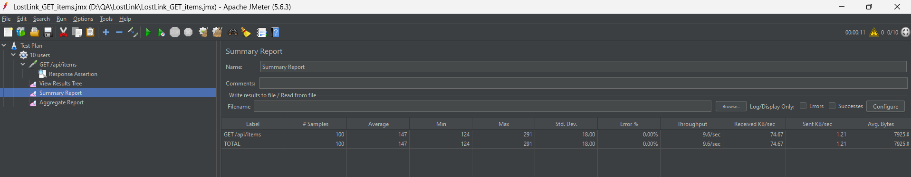

*Figure 3.2: PERF-002, 25 users (250 samples, average 156 ms, 0% errors)*

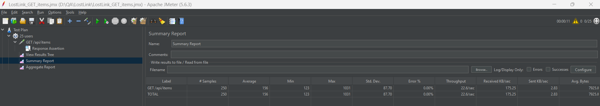

*Figure 3.3: PERF-003, 50 users (500 samples, average 351 ms, 0% errors)*

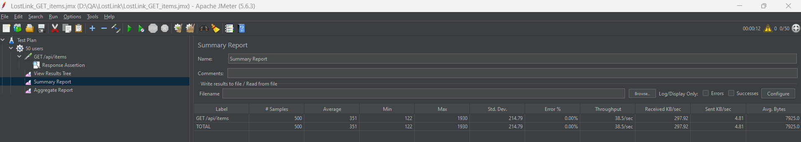

## 4. Security testing (manual OWASP checks)

Authentication and ownership checks held in every test; the only weakness found was a 500 server error on a malformed contact item ID (SEC-010), now fixed.

**Setup:** all requests sent from Postman to the local backend only. Two test users: User A (owner of Item A1) and User B (owner of Item B1, "Red umbrella", id `6b0504a8438f7513826da010`). Each request and response was screenshotted.

| Test ID | OWASP category | Request | Expected | Actual | Result |
| --- | --- | --- | --- | --- | --- |
| SEC-001 | A07 Identification & Authentication | `GET /api/items/my-reports`, no token | 401 | 401 "Please sign in to access this resource." | Pass |
| SEC-002 | A07 | Same, Bearer `abc123` | 401 | 401 "Invalid or expired authentication token." | Pass |
| SEC-003 | A07 | Same, Token A with last character changed | 401 | 401 "Invalid or expired authentication token." | Pass |
| SEC-004 | A07 | Same, valid Token A (control) | 200, only A's items | 200, count 21, every `createdBy` = User A | Pass |
| SEC-005 | A01 Broken Access Control | `PUT /api/items/<Item B1>` with Token A, `{"name":"Hacked by A"}` | 404, no permission | 404 "Item not found or you do not have permission to update it." | Pass |
| SEC-006 | A01 | `DELETE /api/items/<Item B1>` with Token A | 404, no permission | 404 "Item not found or you do not have permission to delete it." | Pass |
| SEC-007 | A01 | `GET /api/items/<Item B1>` afterwards, no token | 200, item unchanged | 200, name "Red umbrella", `createdBy` = User B | Pass |
| SEC-008 | A01 (mass assignment) | `PUT /api/items/<Item A1>` with Token A, `{"name":"Still mine","createdBy":"6b0504a8438f7513826da010"}` | 200, owner unchanged | 200, name updated, `createdBy` still User A | Pass |
| SEC-009 | Input handling | `GET /api/items/abc` | 400 | 400 "Invalid item ID." | Pass |
| SEC-010 | Input handling | `POST /api/contact` with Token B, `{"itemId":"abc", ...}` | 400 | **500** "Unable to send contact request." | **Fail → defect #3** |

**Interpretation**

- **Authentication (SEC-001 to SEC-004):** the JWT middleware rejects missing, fake and tampered tokens, so the signature is genuinely verified, not just checked for presence.
- **Access control (SEC-005 to SEC-008):** SEC-007 confirmed Item B1 exists and belongs to User B, so the 404s in SEC-005 and SEC-006 were caused by the ownership check, not by a missing item. SEC-008 showed the server ignores `createdBy` in update requests, because only whitelisted fields are accepted.
- **Input handling (SEC-009, SEC-010):** the item routes validate ID format, but the contact route did not, so bad user input caused a server error. After the fix (PR #5), SEC-010 returns 400 "Invalid item ID."

**Additional observation:** `npm install` in the frontend reported 3 moderate-severity dependency vulnerabilities (OWASP A06 Vulnerable and Outdated Components). They were not fixed, to avoid changing the group's package versions, and are recorded for follow-up.

**Note on SEC-008:** the request set `createdBy` to another existing object ID (`6b0504a8…`, the Red umbrella item) instead of User B's user ID. The test still shows that a client-supplied `createdBy` value is ignored, because the owner stayed User A (`6b03b68e…208`).

**Evidence**

*Figure 4.1: SEC-001, no token → 401*

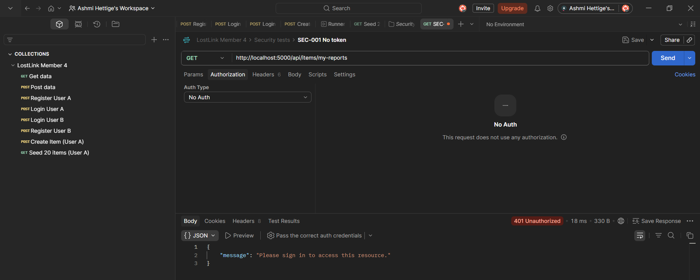

*Figure 4.2: SEC-002, invalid token → 401*

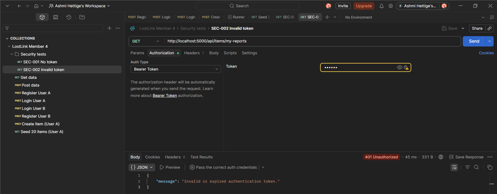

*Figure 4.3: SEC-003, tampered token → 401*

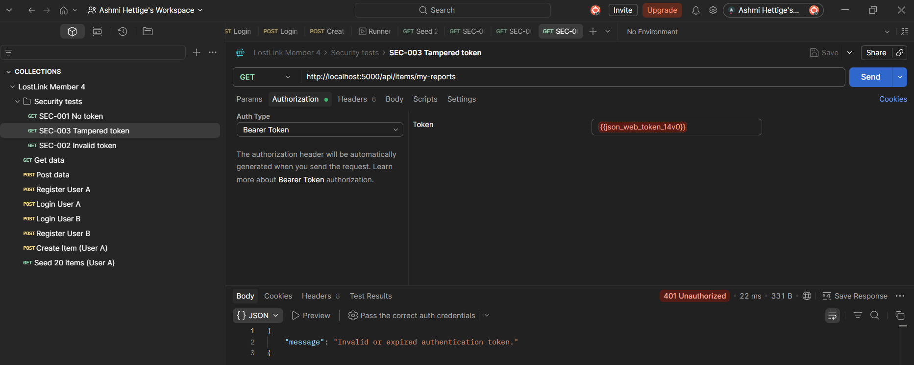

*Figure 4.4: SEC-004, valid Token A → 200, 21 items all owned by User A*

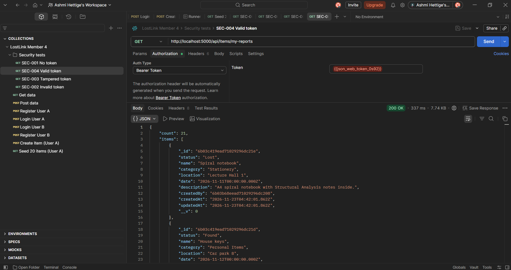

*Figure 4.5: SEC-005, User A edits User B's item → 404 (no permission)*

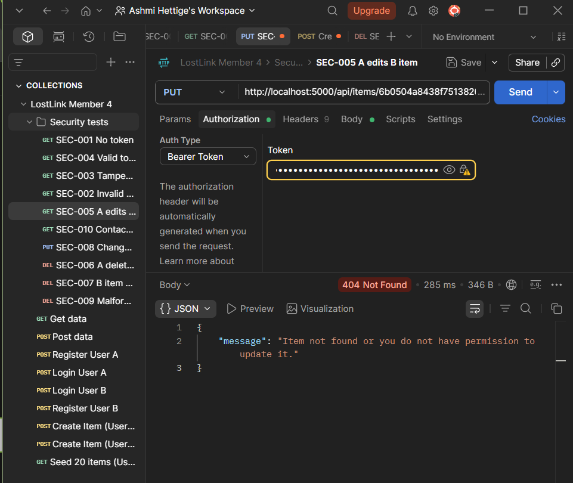

*Figure 4.6: SEC-006, User A deletes User B's item → 404 (no permission)*

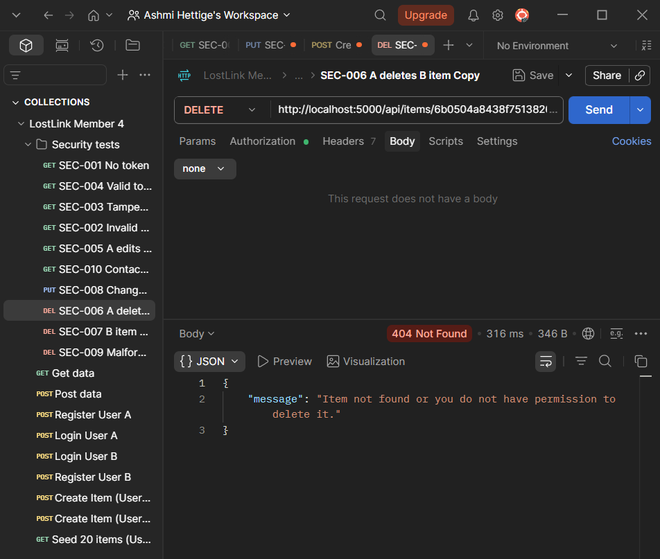

*Figure 4.7: SEC-007, User B's item still exists and is unchanged (`updatedAt` equals `createdAt`)*

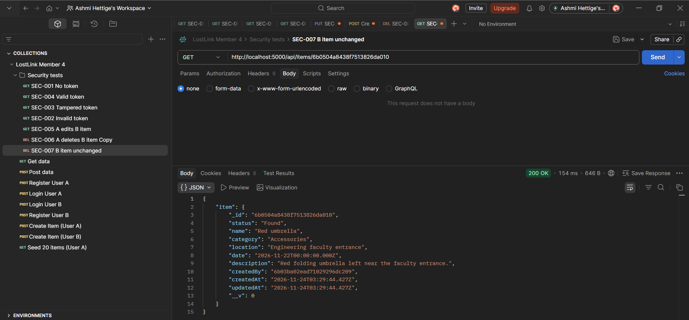

*Figure 4.8: SEC-008, `createdBy` in the request is ignored; owner remains User A*

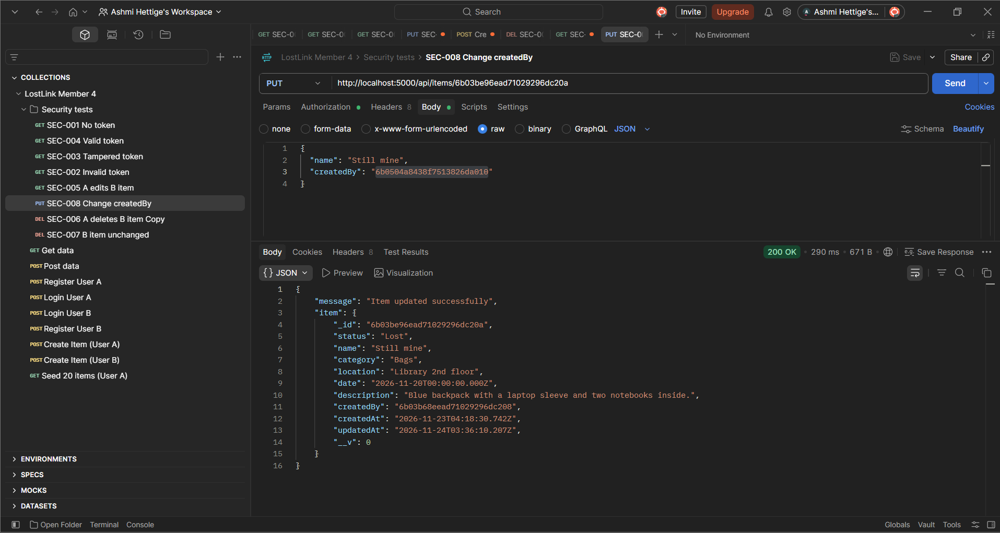

*Figure 4.9: SEC-009, malformed item ID on items route → 400*

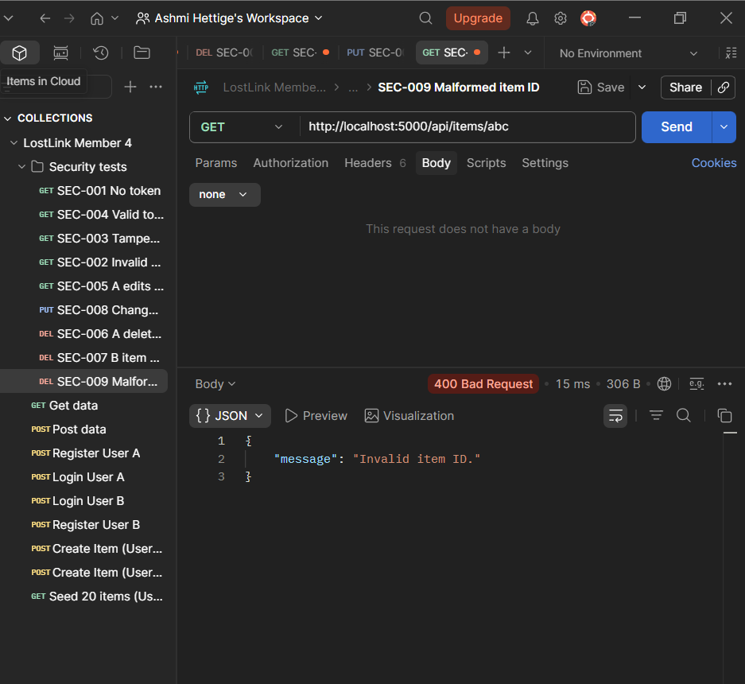

*Figure 4.10: SEC-010, malformed item ID on contact route → 500 (before fix)*

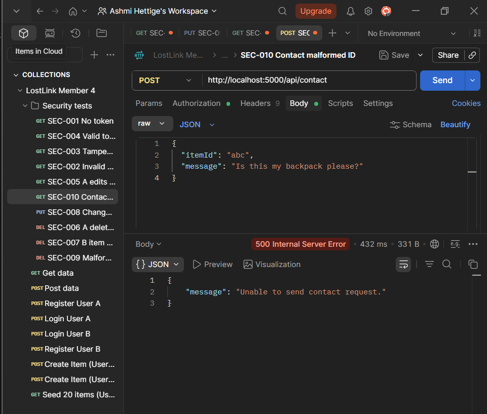

## 5. Usability evaluation

The most serious usability problem is that item owners cannot reply to contact requests, which blocks LostLink's main purpose of returning items (UX-01, logged as #4).

**Method:** two expert-based evaluations of the running app and its frontend code:

1. **Heuristic review** of every page against Nielsen's 10 usability heuristics.
2. **Persona-based cognitive walkthrough** of 5 core tasks (register and log in, find an Electronics item, report a lost item, edit the report, send a contact message) as three personas: a confident first-year student (P1), a non-technical staff member (P2) and a student in a hurry who rarely logs in (P3).

| ID | Page / flow | Finding | Heuristic | Severity | Suggested fix |
| --- | --- | --- | --- | --- | --- |
| UX-01 | Contact Requests | Owner sees only the sender's name and message; no contact details, reply or accept/decline, and status stays "Pending" | Match with real world; user control | High | Show sender's email (with consent) or add a reply/accept action |
| UX-02 | Report an Item (logged out) | Logged-out users can fill in the whole form, then find Submit disabled; going to Login loses the typed data | Error prevention | Medium | Redirect to Login first, or keep form data after login |
| UX-03 | Edit Item | After saving, the app jumps to Browse Items, not the edited item or My Reports | Consistency; user control | Medium | Redirect to the item's details or My Reports |
| UX-04 | Report an Item (success) | No link to view the newly created report | Visibility of system status | Low | Add "View my report" link |
| UX-05 | Report an Item (error) | Server-down message says "make sure the backend is running" (developer wording) | Help users recover from errors | Low | Plain message, e.g. "Service unavailable, try again later" |
| UX-06 | Navigation | Button says "Get Started" but the page says "Register" | Consistency and standards | Low | Use one term in both places |

**Walkthrough summary:** all three personas could complete tasks 2 and 5. P1 and P3 were confused by the Edit redirect (UX-03). P2 hesitated at "Get Started" vs "Register" (UX-06) and, as an item owner, would have no way to reply (UX-01). P3 lost a completed report form by not logging in first (UX-02).

**Good practices:** clear field labels and placeholders, a date picker that blocks future dates, a delete confirmation modal, generic login errors, and navigation that shows account pages only when logged in.

**Limitation:** these are expert evaluations that predict problems from the interface design. No real participants were tested, so task times and satisfaction were not measured. Testing with 3–5 real students and staff is recommended to confirm the findings. Full details: [`usability/usability_evaluation.md`](usability/usability_evaluation.md).

## 6. Defect tracking (GitHub Issues)

Three defects were logged in the group repository's GitHub Issues; one is closed and two remain open for the group to prioritise.

**Process:** every reproducible defect gets one issue using a standard template: test case ID, environment, severity, priority, preconditions, steps to reproduce, expected result, actual result, cause observed (where known) and evidence. Before logging, the expected result was checked against the code and requirements, so a failed test is not reported as a defect by mistake.

**Labels created:** severity (`severity: high`, `severity: medium`, `severity: low`), priority (`priority: P1`–`P3`), lifecycle status (`status: new`, `status: assigned`, `status: fixed`, `status: verified`) and type (`bug`, `security`, `usability`, `configuration`). Severity describes impact; priority describes how soon to fix.

| Issue | Title | Found by | Severity | Priority | Status |
| --- | --- | --- | --- | --- | --- |
| #3 | `POST /api/contact` returns 500 instead of 400 for a malformed itemId | SEC-010 | Medium | P2 | Closed (fixed in PR #5, verified) |
| #4 | Item owners cannot reply to or act on contact requests | UX-01 | High | P2 | Open |
| #2 | Server fails to start when `.env` is created from `.env.example` (`MONGO_URI` vs `MONGODB_URI`) | Environment setup | Medium | P2 | Open |

**Failed tests from other workstreams (triaged, not logged as defects):** before logging, each reported failure was checked against the expected behaviour.

- **TDD password-length validator (`feature/whitebox-tdd`):** 4 tests (7, 8, 72 and 73 characters) failed with `expected undefined to be true/false`. This was the intentional **Red** stage of the Red → Green → Refactor cycle: the tests were written before the function was implemented, so it returned `undefined`. They passed once the implementation was added, so no defect exists.
- **White-box test suite:** all tests passed, including tests that deliberately exercise error paths (duplicate-key and unexpected database errors). Passing tests on error paths show the errors are handled correctly, so no defect exists.

No further defects were reported by the other workstreams at the time of writing.

**Evidence**

*Figure 6.1: Labels created in the repository for severity, priority, lifecycle status and type*

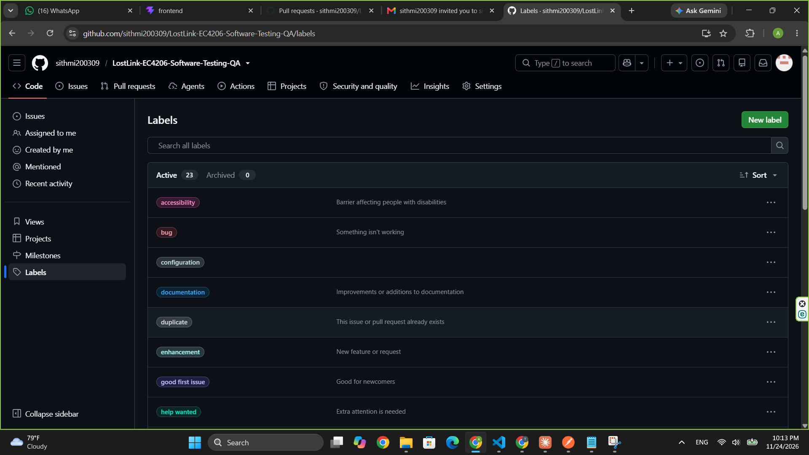

*Figure 6.2: Defect #2: backend fails to start when `.env` uses `MONGO_URI` from `.env.example`*

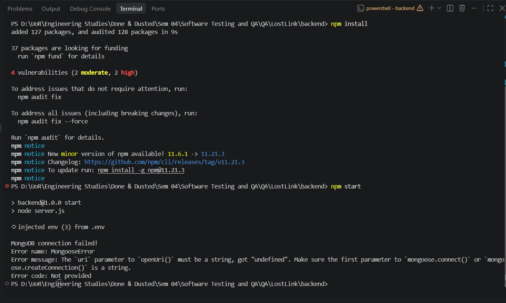

## 7. Root cause analysis

Both defects come from inconsistency between parts of the codebase that should follow the same rule, and neither could be caught by testing only through the website.

### RCA 1: Issue #3, contact route returns 500 for a malformed itemId

| Part | Analysis |
| --- | --- |
| Symptom | `POST /api/contact` with `itemId: "abc"` returned 500 "Unable to send contact request." instead of a 400 validation error (SEC-010). The backend log showed a Mongoose CastError. |
| Why 1 | Why 500? `Item.findById("abc")` threw a CastError because "abc" cannot be converted to a MongoDB ObjectId. |
| Why 2 | Why was it not returned as a client error? The controller's catch block treats every exception as a server error. |
| Why 3 | Why did the bad ID reach the database query? `sendContactRequest` had no ID-format check before the lookup. |
| Why 4 | Why was it missing here but not elsewhere? The item controller validates IDs with `mongoose.isValidObjectId()`, but the contact controller was written separately without the same rule. |
| Why 5 | Why was the inconsistency not noticed? There was no shared validation helper and no negative API tests; the frontend only ever sends real IDs, so manual UI testing could not trigger it. |
| Root cause | Inconsistent input validation between controllers: the contact controller skipped ID-format validation. |
| Corrective fix | Added a `mongoose.isValidObjectId(itemId)` check that returns 400 "Invalid item ID." before the database lookup (PR #5). |
| Preventive actions | Move ID validation into a shared helper or middleware used by all routes; add malformed-ID cases to the Postman suite and CI; add "validate all inputs" to the pull request review checklist. |

### RCA 2: Issue #2, server fails to start from `.env.example`

| Part | Analysis |
| --- | --- |
| Symptom | Following the example config, the server stopped at startup: "The `uri` parameter to `openUri()` must be a string, got undefined". |
| Root cause | `.env.example` defines `MONGO_URI`, but `backend/config/db.js` reads `process.env.MONGODB_URI`. The example file was not updated when the variable name changed, and the app does not check for required variables at startup. |
| Why earlier checks missed it | The original developer already had a working `.env`, so the mismatch only appears for a new developer setting up from scratch. |
| Corrective fix | Rename the variable in `.env.example` to `MONGODB_URI` (or make `db.js` read the documented name). |
| Preventive actions | Validate required environment variables at startup with a clear error message; include a "fresh clone setup" check in the onboarding or CI steps. |

## 8. Bug lifecycle: Issue #3

Issue #3 went through the complete lifecycle on 24 November 2026, from discovery to a verified, closed fix, with each stage recorded on GitHub.

| Stage | What happened | Evidence |
| --- | --- | --- |
| New | Defect found by SEC-010 and logged with the issue template; labels `bug`, `security`, `severity: medium`, `priority: P2`, `status: new` | Figure 8.1 |
| Assigned | Member 4 self-assigned the issue (shown in the issue timeline) | Figure 8.2 |
| Fixed | Fix made on branch `fix/contact-invalid-id` (added `isValidObjectId` check in `contactController.js`), tested locally (SEC-010 → 400) and opened as PR #5. A review was requested from the repository owner (sithmi200309), who merged it into `main`. The "Member 3 – LostLink Automation Tests" GitHub Actions check ran on the pull request and passed. Label changed from `status: new` to `status: fixed` | Figures 8.3–8.5 |
| Verified | `main` pulled after the merge, backend restarted, SEC-010 re-run: 400 "Invalid item ID." Result posted on the issue; label changed to `status: verified` | Figures 8.6, 8.7 |
| Closed | Issue closed after successful verification; final labels include `status: verified` | Figure 8.7 |

**Traceability note:** the fix commit message originally referenced "#2" by mistake. The PR #5 description was corrected to "Refs #3", and the issue comment now links PR #5, so issue, pull request and fix are traceable. The commit message itself was left unchanged to avoid rewriting merged history.

**Evidence**

*Figure 8.1: New: Issue #3 created with `status: new`*

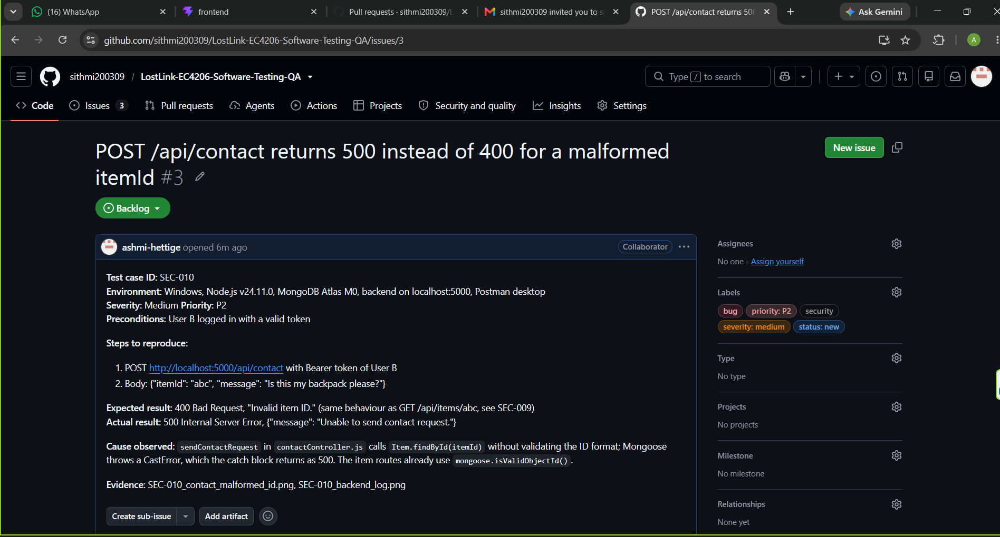

*Figure 8.2: Assigned: issue self-assigned to Member 4*

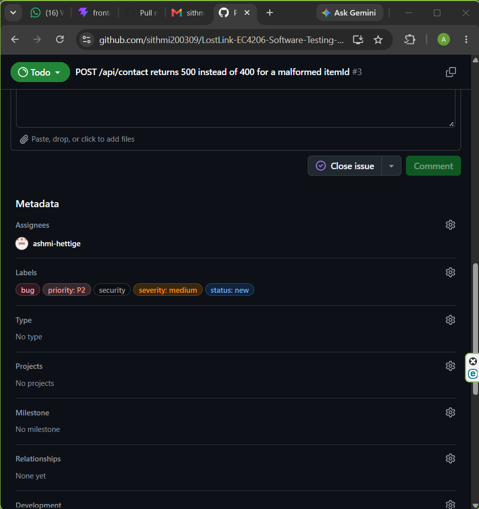

*Figure 8.3: Fixed: label changed to `status: fixed`, with the issue timeline showing each change*

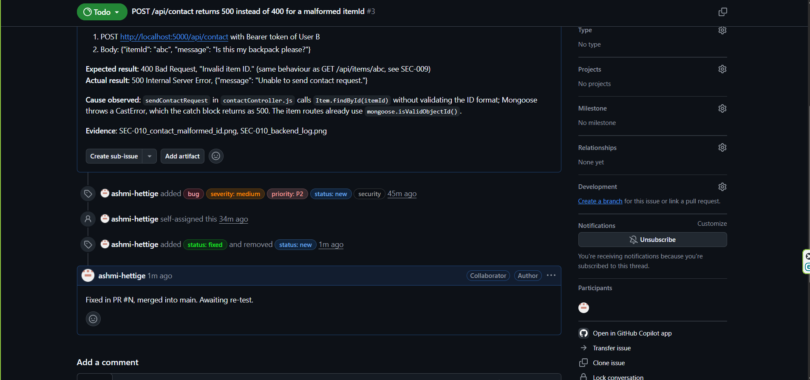

*Figure 8.4: PR #5 merged into `main` from `fix/contact-invalid-id`*

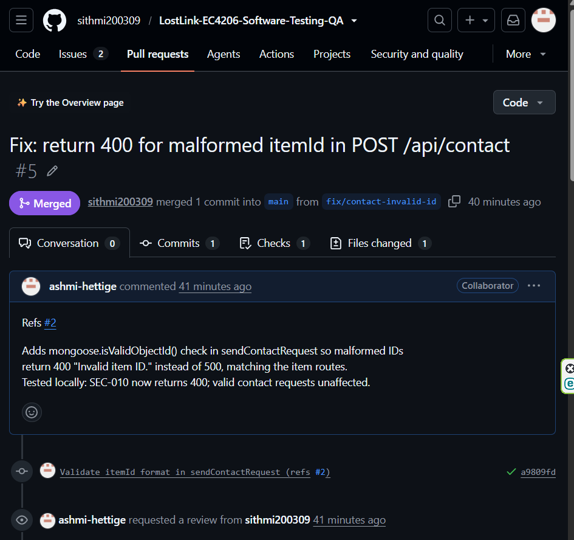

*Figure 8.5: CI check "Member 3 – LostLink Automation Tests" passed on PR #5*

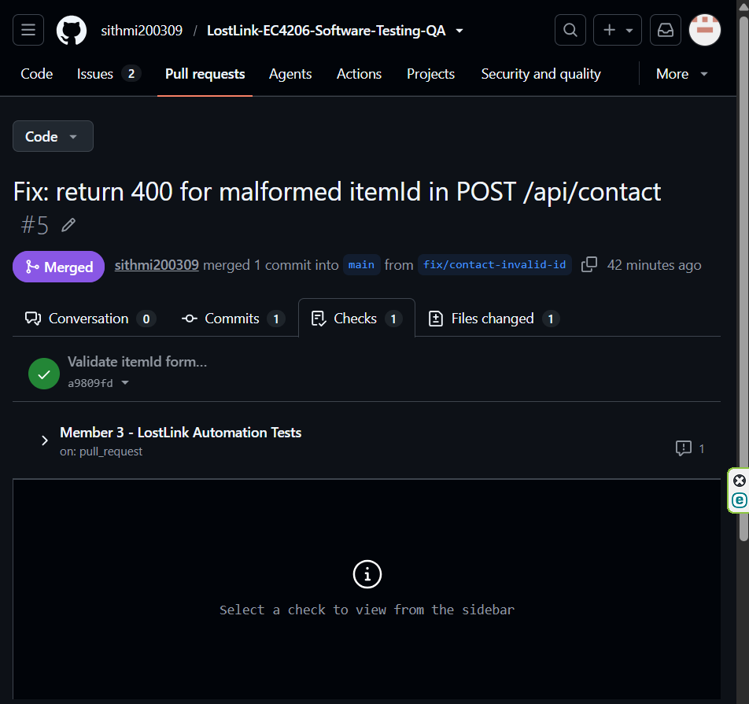

*Figure 8.6: Verified: SEC-010 re-run on `main` returns 400 "Invalid item ID."*

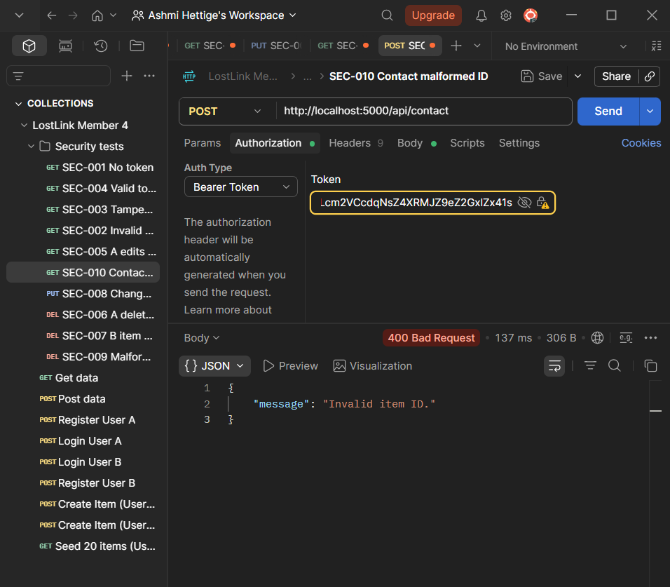

*Figure 8.7: Closed: Issue #3 closed (Done) with label `status: verified`*

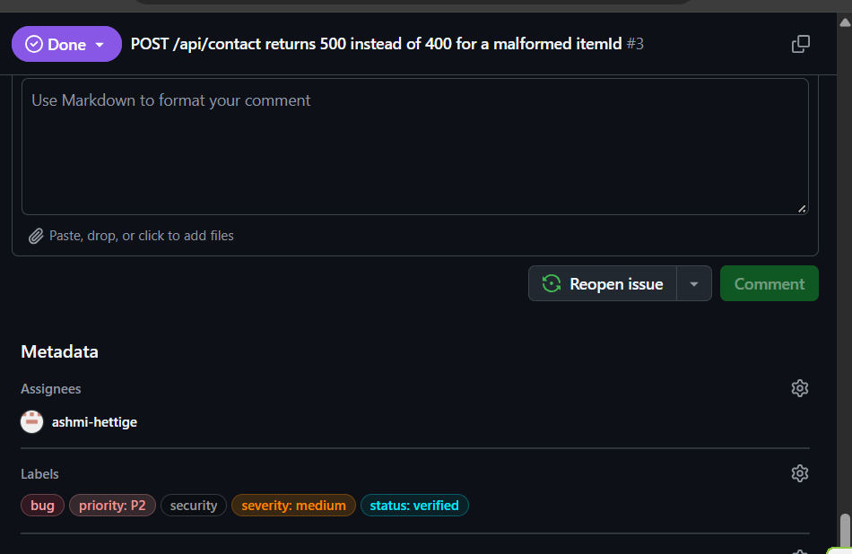

## 9. Agile/DevOps reflection

Working in small, separately owned workstreams with branches, pull requests, issues and an automated CI check made defects visible early and kept every change traceable.

**Small tasks and clear ownership.** The work was split into four workstreams (test planning and black-box; white-box and TDD; BDD, automation and CI; non-functional testing and defects), each with its own branch: `feature/test-planning`, `feature/whitebox-tdd`, `feature/automation-bdd` and `feature/non-functional-testing`. Members could work in parallel without overwriting each other's files.

**Branches and pull requests.** Changes reached `main` only through pull requests. PR #1 (automation and BDD) and PR #5 (the contact-ID fix) were merged after review, and Member 4's evidence was submitted the same way. The fix used a short-lived `fix/contact-invalid-id` branch, keeping the code change separate from test evidence and easy to review.

**Continuous integration.** The GitHub Actions workflow added by Member 3 ran automatically on pull requests. It passed on PR #1 (2/2 checks) and on PR #5 (1/1), so the fix was checked automatically before merging, not only by hand. The workflow, named "Member 3 – LostLink Automation Tests", is triggered on pull requests (Figure 8.5). On a fresh Ubuntu runner it checks out the code, sets up Node.js 24, installs backend and testing dependencies with `npm ci`, starts its own MongoDB 7 service container, launches the LostLink backend, waits until `GET /api/items` responds, and then runs the Cucumber BDD tests (`npm run test:bdd`) and the Newman API tests from the Postman collection. Newman results are uploaded as a build artifact, and backend logs are printed if a step fails. It uses a CI-only placeholder `JWT_SECRET` and a throwaway database, so no real credentials or data are exposed. A possible next step is adding the white-box unit tests and a malformed-ID negative case to this pipeline, so defects like #3 are caught automatically.

**Shared defect tracking.** Defects were logged as GitHub Issues with consistent severity, priority and status labels, and linked to the pull request that fixed them. Issue #3 shows the full loop (found → logged → assigned → fixed in a PR → checked by CI → re-tested → closed) within one day, which shows how fast feedback can be when testing and fixing share one workflow.

**What we would improve.** Two of the defects were inconsistencies that a shared validation helper, negative API tests in CI, and a "fresh clone" setup check would have prevented. A small slip (a commit referencing the wrong issue number) also showed the value of checking issue numbers before committing and using pull request templates.

## 10. Evidence index

All evidence is in this folder (`testing/non-functional-testing/`) in the `main` branch, added via the `feature/non-functional-testing` pull request and later moved inside `testing/`.

| Folder | Files | Supports |
| --- | --- | --- |
| `performance/` | `LostLink_GET_items.jmx`; `PERF-001_10users_summary.png`, `PERF-002_25users_summary.png`, `PERF-003_50users_summary.png` | Section 3 |
| `security/` | `LostLink_Member4.postman_collection.json` (tokens removed); `SEC-001` to `SEC-010` screenshots; `SEC-010_retest_on_main.png` | Sections 4, 8 |
| `usability/` | `usability_evaluation.md` | Section 5 |
| `defects/` | `BUG-001_env_mismatch.png`; `GH_labels.png`; `LC-1_new.png`, `LC-2_assigned.png`, `LC-3_fixed.png`, `LC-5_closed.png`; `PR_merged.png`; `PR5_ci_passed.png` | Sections 6–8 |

GitHub references: Issues #2, #3, #4; Pull Request #5 (fix for #3); Member 4 evidence pull request (`feature/non-functional-testing` → `main`).
